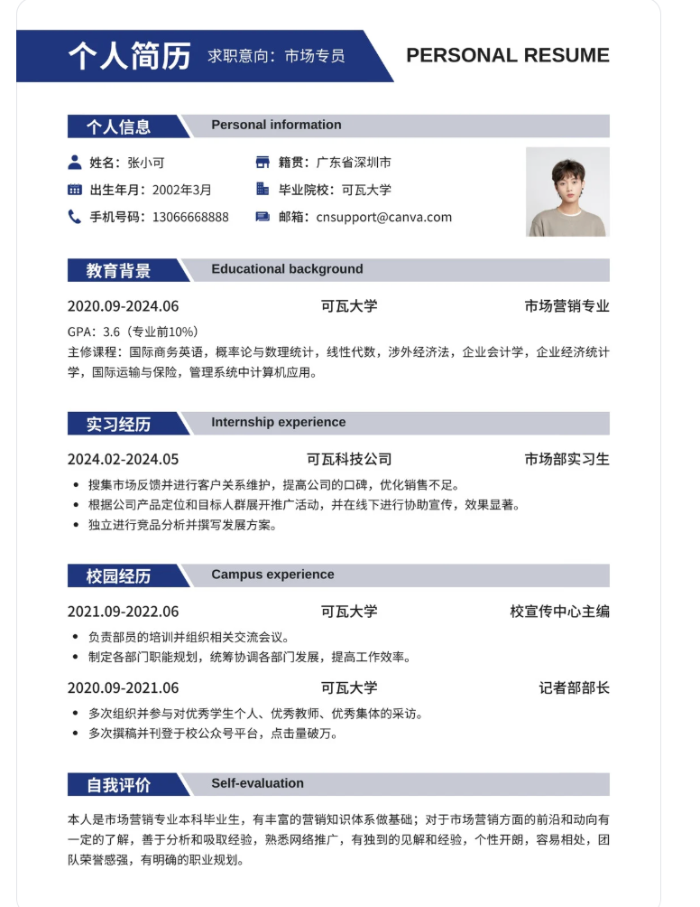
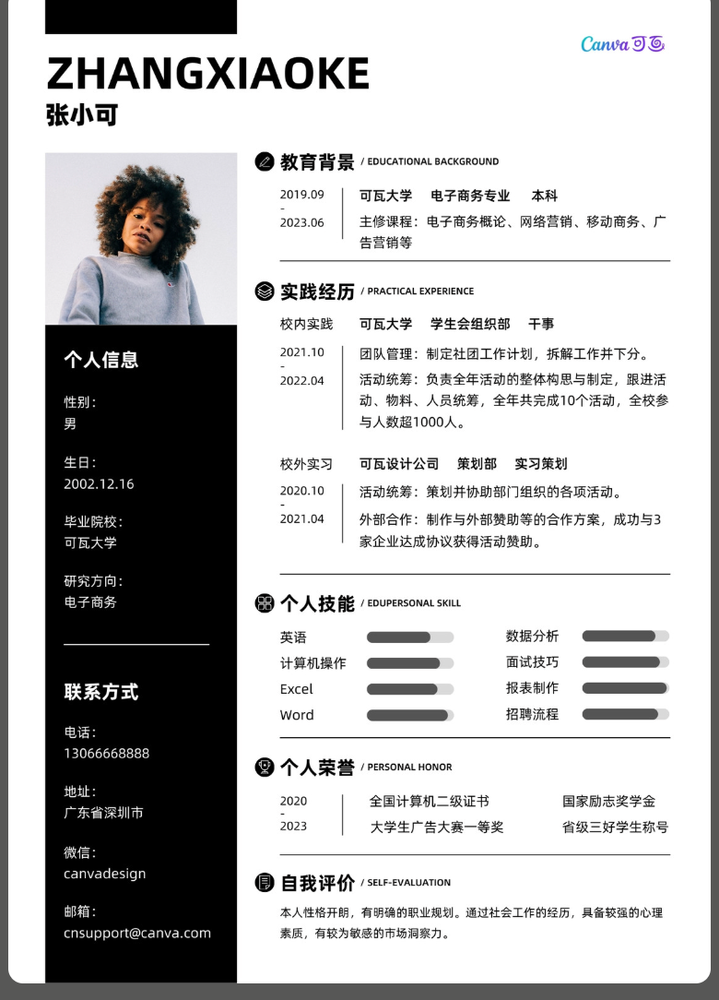
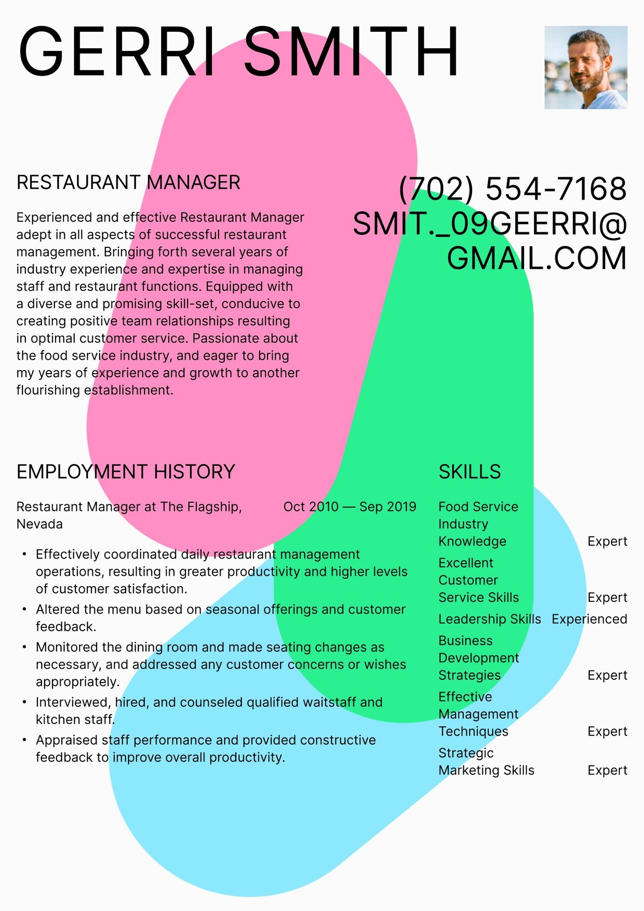
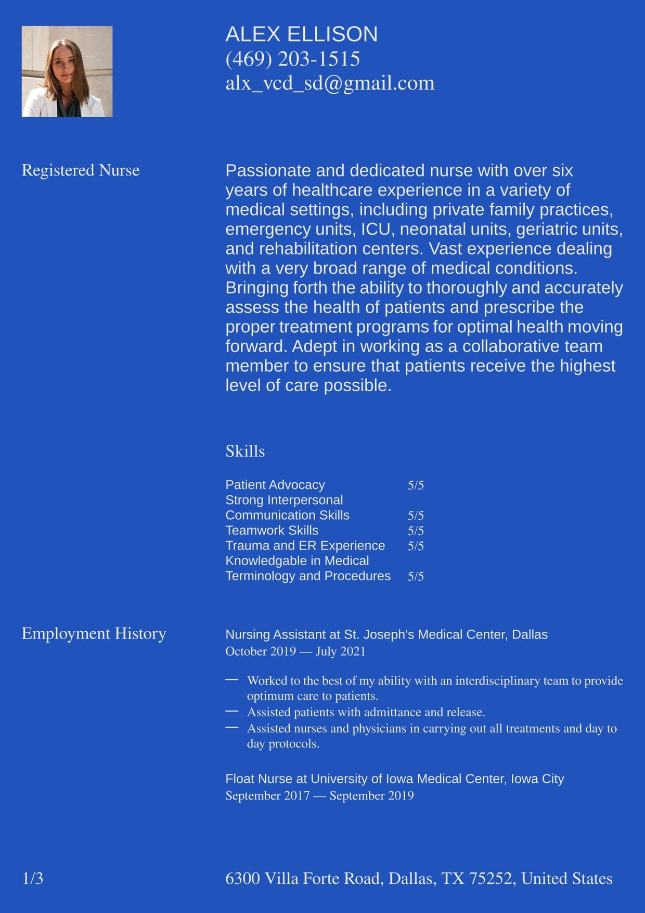
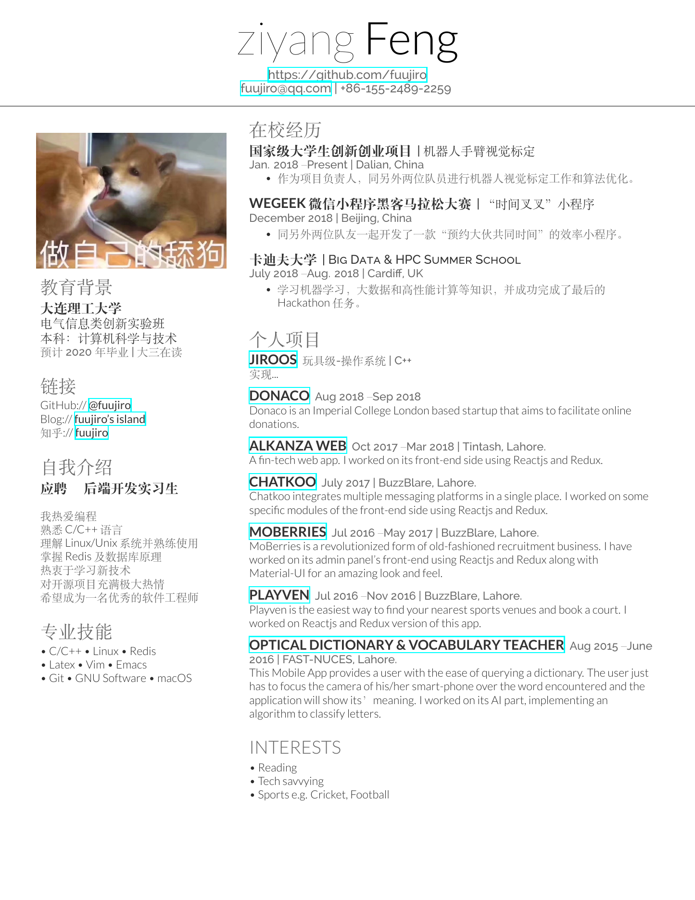

# Bad Case 索引

实际作品数：5。人工反馈确认数：2（B001 质量低分区间 1、B002 明确否决采用 1）；B003—B005 为 2026-10-17 v1.2.0 检索中由 Bot 按用户“补充典型差例”的指示挑选，属于 Bot 初评低分／待人工复核，不是人工真值；人工精确评分数：0。首轮约 5 个的目标已满，均为实际看过的图片，没有补造差例。

维护规则见 [案例库说明](../模板库说明.md) 和 [模板筛选标准](../../../references/template-search-and-screening.md)。

## B001 · 蓝灰标题条单栏简历

类型：普通模板被评为优秀；作为高质量视觉参考的价值被高估。不是已证明无法求职使用，也不是可读性严重失效的样本。

### 来源与范围

- 来源：用户在本次对话提供的完整模板截图，已实际看图。原网页链接、作者及源文件未提供，不能依据示例邮箱认定来源平台。
- 已取得：正文 1 页，PNG，776 × 1004；未声明存在续页。不包括其他两套模板。
- 原图片 SHA-256：`558be3bd5803eb40a48ce79f5628bd88dbacb3bd79d6e15a686a5c42ea839a72`。
- 模板为中文；市场地区未独立核实，不计入任何推荐地区配额。
- 源文件未提供；中文未实际试排；PDF 未导出。只依据截图讨论设计，不认定可编辑或已验证可用。

### 外部 Bot 的历史判断

这些结果由用户提供的截图保留，模型、运行设置及当时实际使用的完整规则版本未知；不能追认为本地 v1.0.0 的测试结果。

| 次序 | A | B | C | D | E | 综合分 | 截图中的理由 |
| --- | --- | --- | --- | --- | --- | --- | --- |
| 初评 | 4 | 5 | 4 | 4 | 4 | 4.30 | 截图列出分数，未提供这张图完整的逐维理由 |
| 复评 | 4 | 4 | 4 | 4 | 4 | 4.00 | 认为分组、栏目与经历归属清楚；承认初评 B=5 缺少图上证据，调为 4 |

[初评分数证据](B001-蓝灰标题条/Bot初评.png)、[复评分数及理由证据](B001-蓝灰标题条/Bot复评.png)。两次加权算术正确，不代表评分依据充分；历史分不覆盖。

### 人工反馈

- 原话：“我觉得图一适合3分或者2分。因为它很普通。”
- 人工总体评价：约 2—3 分，认为普通，不应按当前优秀参考目标评为 4 分。
- 精确总分：未提供；A／B／C／D／E 人工分项：均未提供。不取中点 2.5，不把低分分摊到所有维度。
- 可确认的质量结论：不应列入这轮 4 分以上的优秀模板正式推荐；不是只因个人不喜欢而拒绝。
- 记录日期：2026-10-16。反馈依据为视觉质量直觉，未声明使用某个规则版本；不能当作已确认的新版精确答案。

### 对规则的启示与复查边界

旧标准把基础规整、易替换和没有明显错误当成优秀依据，可能系统性抬分。修订应让 3 分表示普通合格，4 分要求具体优秀依据，并检查视觉项的准入；不能见到蓝色横条就扣分，不能为了贴近人工区间编造阅读缺陷。

同图新旧规则的隔离评分见 [运行记录](../benchmark/runs/v1.1.0-C001.md)。此图参与制定新版，属于样本内开发检查，不能宣称为独立泛化验证。

## B002 · 黑色侧栏双栏简历

类型：本次简历已被用户否决的候选。现有标准已将其挡在正式推荐之外，本例没有触发评分规则修改。

### 来源与 Bot 原判断

- 来源：用户在本轮对话提供的 PNG 截图，已实际查看。具体作品页、作者、授权及源文件未核验；不根据示例人物或邮箱推断用户信息。
- 已取得 1 张截图，780 × 1084，SHA-256：`f5a5d4177aaf69407fbab5d3831bca2f3cc65855d9fe877226bb78af983b6900`。评估限可见页面，不推断续页；图顶装饰触及截图边缘，不能声称已检查完整源文件。
- 规则版本：v1.1.0。原 Bot 分保留为 A=3、B=3、C=3、D=3、E=3.5，原加权值 3.025，显示 3.03／5。
- Bot 观察：黑色资料侧栏占幅较大，主栏文字空间偏窄；日期断行与细小双语标题使阅读节奏零碎。重复分隔线、日期窄栏及元素关系可提取，E 略高于普通档；技能进度条未给出衡量依据，但不据此编造示例人物的能力真假。
- 未过原因：S<4，且 A／B／D 未达到共同下限；两种设计用途均不进入正式推荐。C／E 为据图预估，未试排或重建。源文件、实际中文替换及 PDF 导出未验证。

### 人工反馈与适用范围

- 原话：“图一不行 对的 要修改标准吗”。
- 确认结论：这张模板不采用。人工没有给出精确分或逐维评分，也没有逐项确认上述 Bot 原因；不得把 3.03 当成人工评分。
- 不由此推断用户拒绝所有黑色、所有侧栏或所有双栏。该模板的否决结论与普遍质量规则分开保存。
- 当前未将本例纳入固定质量 Benchmark：用户已确认采用层面的否决，但尚未单独确认质量与偏好标注。bench-v1／labels-v1 保持原样，不自动增加样本或补造人工答案。
- 复盘：现有规则执行结果与本次否决一致，保留 v1.1.0，无新增评分条款；后续若出现高分误推荐或明确漏判，再检查规则缺口。

## B003 · 彩色色块背景

类型：装饰喧宾夺主，正文可读性严重受损。几块大型彩色有机形状直接压在正文后面，与 B001（普通色条被高估）、B002（黑色侧栏挤压主栏）的问题不同。

### 来源与范围

- 来源：Resume.io 模板 Cape Town，模板列表页 https://resume.io/resume-templates （该站模板没有独立详情页）。图片是该站官方模板预览原图，JPG，1240×1753，已取得 1 页。SHA-256：`c7557015a76fefcc976bb6a8436c00ee887cb8ec0166cc2f4f6b9143809fbdda`。
- 项目记录 ID：N-I10（v1.2.0 首轮）。地区：其他地区（英文、美式示例）。源文件属在线编辑器，未取得。

### Bot 原判断（v1.2.0）

| A | B | C | D | E | 综合分 | 置信度 |
| --- | --- | --- | --- | --- | --- | --- |
| 2 | 2 | 2.5 | 3 | 2.5 | 2.33 | 高 |

- 粉、绿、蓝三块大色块压在正文后面，经历、技能文字落在不同底色上，对比度忽高忽低（A2）。
- 邮箱用全大写巨字排成“SMIT._09GEERRI@ / GMAIL.COM”并折行，难以辨认；技能名多次折行，“Expert/Experienced”等级词对不齐（B2）。
- 装饰占据大量版面（C2.5）；风格有个性，但不适合正式求职（D3）。
- 两种用途都不通过。

### 人工反馈

- 待人工复核；人工分与结论留空。

## B004 · 满版蓝底反白

类型：整页饱和底色加反白文字，同时有字体混排和信息错位，属于配色与排版基础失误。与 B002 不同：B002 是局部深色侧栏挤压主栏，这里是整页底色导致阅读疲劳、打印困难。

### 来源与范围

- 来源：Resume.io 模板 Geneva，模板列表页 https://resume.io/resume-templates 。官方模板预览原图，JPG，1240×1753，已取得第 1 页；页脚显示“1/3”，第 2—3 页未取得。SHA-256：`a7809128d3c75ad79570f096e566d33001a70e6adc6ba0f4dc1d634bbeb62c29`。
- 项目记录 ID：N-I07（v1.2.0 首轮）。地区：其他地区。

### Bot 原判断（v1.2.0）

| A | B | C | D | E | 综合分 | 置信度 |
| --- | --- | --- | --- | --- | --- | --- |
| 2.5 | 2 | 3 | 2.5 | 3 | 2.43 | 高 |

- 满版饱和蓝底配白字，Times 与 Arial 在同一层级内混用（A2.5）。
- 技能分数“5/5”与折行的技能名错位；地址被放到页脚；单页示例显示“1/3”（B2）。
- 配色刺眼（D2.5）。两种用途都不通过。只评已取得的第 1 页。

### 人工反馈

- 待人工复核；人工分与结论留空。

## B005 · 超链接框双栏

类型：编译默认样式和示例内容不专业，是中文 LaTeX 模板里常见的问题。青色超链接框遍布全页，表情包头像、玩笑示例、中英混杂，排版细节也有错误。骨架本身尚可，失败主要在专业可信度（B）。

### 来源与范围

- 来源：Overleaf 模板 cv_cool_CN（作者 fuujiro），https://www.overleaf.com/latex/templates/cv-cool-cn-zhong-wen-jian-li-mo-ban-ke-fu-tou-xiang/srhqpcztnjym 。图片是 Overleaf 模板预览的 PDF 渲染，PNG，1445×1870，已取得 1 页。SHA-256：`eb0ed0d28d3d4e204bd10db50b441c2d774f0dfd5511fae367af72e5135f338d`。
- 项目记录 ID：N-O03（v1.2.0 首轮）。设计族：Deedy 双栏的中文改版。地区：国内（中文示例）。LaTeX 源码公开，未核验。

### Bot 原判断（v1.2.0）

| A | B | C | D | E | 综合分 | 置信度 |
| --- | --- | --- | --- | --- | --- | --- |
| 3 | 2 | 3.5 | 2.5 | 3.5 | 2.65 | 高 |

- 细体 Lato 与宋体混排，灰字偏淡（A3）。
- 青色超链接框遍布，头像是表情包，中英文示例混杂，日期“2018 -Present”间距错误（B2）。
- Deedy 双栏骨架尚可（C3.5）；视觉偏粗糙（D2.5）。两种用途都不通过。

### 人工反馈

- 待人工复核；人工分与结论留空。

## 后续收录

约 5 个精选例保存在这里；其他已评失败结果留在项目记录。保留真实图片、来源、Bot 原分及理由、人工反馈与规则版本。打不开、裁切或模糊导致的“待检查”不是已证明质量差，不能充当低分真值。后续人工更改评价时追加记录，不静默改旧分或移动、删除样本。
