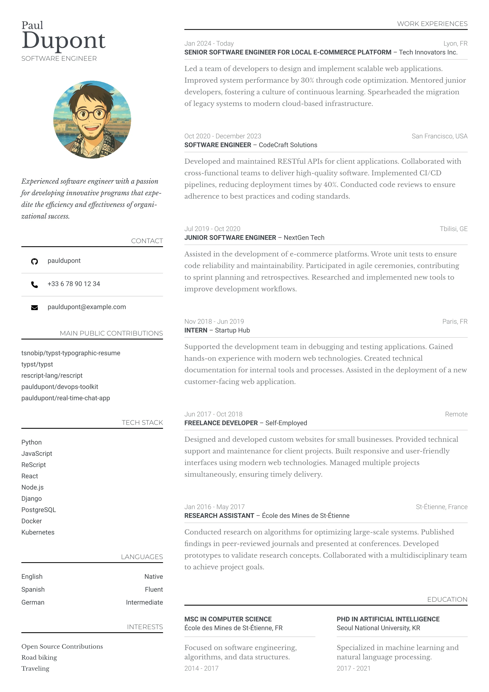
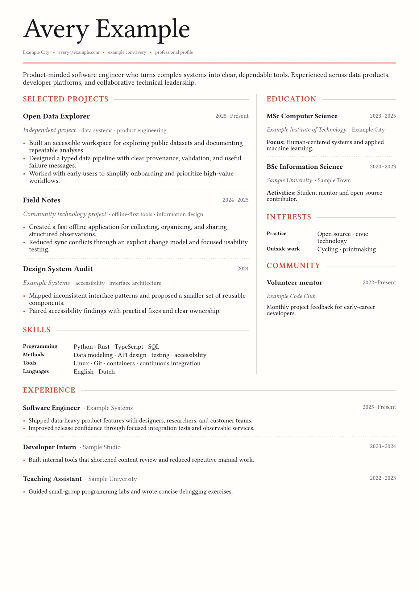
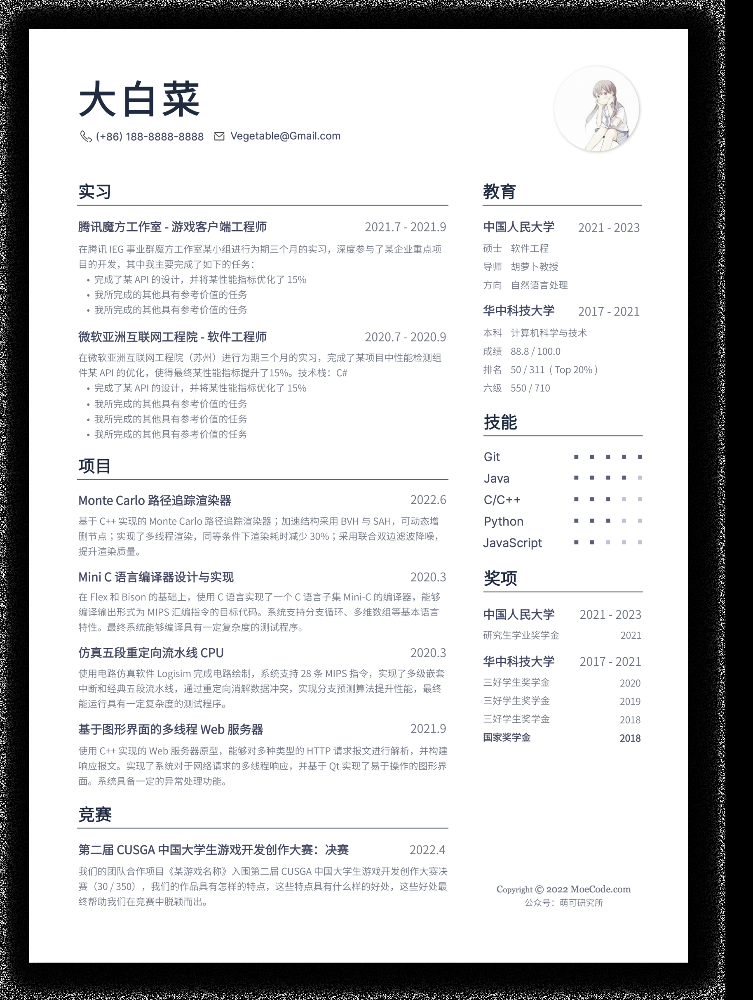
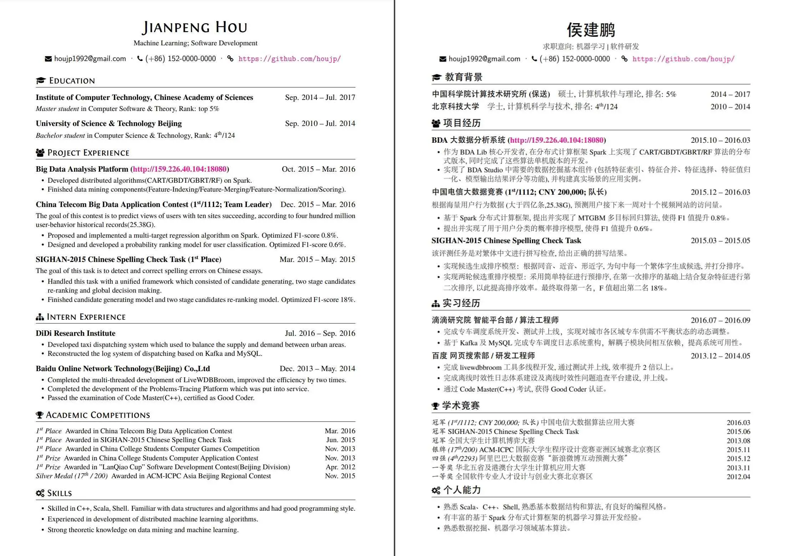

# Good Case 索引

实际作品数：4。人工确认数：4。确认的是“收录为 Good Case”，人工精确评分数为 0。4 例均由用户在 2026-10-17 的 v1.2.0 检索之后指定收录；其中 G004 的 Bot 综合分未达 4.0，是按用户判断收录。图片均为实际查看过的预览或截图。源文件、中文试排和 PDF 导出都未核验，没有一例是可以直接使用的母版。

维护规则见 [案例库说明](../模板库说明.md) 和 [模板筛选标准](../../../references/template-search-and-screening.md)。

## 用途视图

- 视觉灵感：4 个（G001、G002、G003、G004）。用于参考字体、留白、网格、层级和风格。
- 实用模板候选：3 个（G001、G002、G003），按 Bot 初评达到实用准入（S≥4.0，A/B/D≥4，C/E≥3.5）。G004 的 Bot 分未达实用门槛；用户认可的是它的整体水准，不等于已核验可用。
- 同一作品可以同时带两个标签，只用一个 ID 和一份图片，不重复计数。
- 地区：国内 2（G003、G004），其他地区 2（G001、G002）。正式推荐目标是 10—20 个、60:40，当前远未达到。

## 实际条目

### G001 · typographic-resume

- 身份与来源：Typst Universe 包 typographic-resume，https://typst.app/universe/package/typographic-resume 。设计族自成一族。首次出现在 v1.1.0 轮（项目 ID T09），v1.2.0 轮做了有范围复评。地区：其他地区，依据是英文示例、面向海外通用岗位。语言：英文。
- 图片证据：Typst 官方缩略原图，PNG，2480×3508，共 1 页，未声明有续页。SHA-256：`50325d73b0c69a8a46dfefc260082d2f6d2d5d97d54ef93b39573990ca0dec18`。
- Bot 初评（v1.1.0 原分，v1.2.0 复评维持）：A4 / B4 / C4 / D4.5 / E4.5，综合 4.15，置信度高。
  - 观察：左侧窄栏放联系方式、贡献、技术栈、语言、兴趣，右侧主栏放经历和教育。小型大写栏目名配右对齐细线；条目分三层：灰色日期/地点行、粗体职位—公司、衬线正文。留白节奏和字体层级在本批中最出色。
  - 反向检查：正文是浅灰衬线，打印后可能偏淡；技术栈只是名词列表，没有分级；示例头像是插画。这些是它没有拿到更高 A/B 分的原因。
- 用途：视觉灵感 + 实用模板候选。
- 实用状态：源文件未取得（Typst 包，公开可下载），未核验；中文试排未做；PDF 导出未做。
- 人工复核：用户在 2026-10-17 指定收录为 Good Case（由协作 Agent 转述）；没有人工分或分项，人工分留空。
- 后续重评：无。

### G002 · heading-resume

- 身份与来源：Typst Universe 包 heading-resume，https://typst.app/universe/package/heading-resume 。首次出现在 v1.1.0 轮（T05），v1.2.0 复评维持。地区：其他地区，依据是英文示例。语言：英文。
- 图片证据：Typst 官方缩略原图，PNG，1358×1920，共 1 页。SHA-256：`355664693242ffbf9fc2bbfb09203ed4ba5b01265bc8c4d7722ce346b510e60b`。
- Bot 初评：A4 / B4 / C4 / D4 / E4，综合 4.00，刚好达线，置信度高。
  - 观察：大号衬线姓名加红色细线页眉。上半部分是“项目/技能 + 教育/兴趣”双栏，下半部分改为通栏经历。红色小型大写标题延伸出细线，条目为粗体名称—斜体副行—右侧日期，虚线分隔，结构清楚、稳健。
  - 反向检查：页面下方约 1/6 是空白；联系行的字号很小；上下两种栏式切换后，阅读路径需要适应。各项都没有明显超出 4 分的地方。
- 用途：视觉灵感 + 实用模板候选。
- 实用状态：源文件未取得/未核验；中文试排未做；PDF 导出未做。
- 人工复核：用户在 2026-10-17 指定收录（协作 Agent 转述）；人工分留空。
- 后续重评：无。

### G003 · DrawCV（左对齐带头像版）

- 身份与来源：GitHub 仓库 Zilize/DrawCV，https://github.com/Zilize/DrawCV ，基于 Draw.io 绘制。设计族自成一族；仓库内的 Middle（居中）、Indent、Serif、Gray 是同族变体，不另计。首次出现在 v1.2.0 轮的国内补充批（N-D01）。地区：国内，依据是中文内容、国内高校与企业示例、作者面向国内计算机专业求职。语言：中文。
- 图片证据：截图，裁自仓库 `asset/Serif.png` 的左半页，即作者推荐的无衬线版本。PNG，1827×2424，共 1 页；预览外圈带作者加的投影。SHA-256：`6025349fb1ccf113ef06d9d4ac28bf70ceb85151153d2390ed15e3cb92730a5a`。
- Bot 初评（v1.2.0）：A4 / B4 / C4 / D4 / E4.5，综合 4.03，置信度高。
  - 观察：宽栏放实习、项目、竞赛，窄栏放教育、技能、奖项，比例合理。思源黑体配 Inter，层级分三层：标题、灰色右对齐日期、灰色正文。教育一栏用键值对齐；藏青加灰的低饱和配色、细线标题，克制精致，不属于色条模板。
  - 反向检查：正文灰字偏浅偏小；技能五点评级没有刻度说明；示例里“我所完成的其他具有参考价值的任务”重复占位；头像是插画。
- 用途：视觉灵感 + 实用模板候选。
- 实用状态：仓库提供 .drawio 源文件，但未下载核验；中文试排未做；PDF 导出未做。作者注明导出前要删除辅助线框。
- 人工复核：用户在 2026-10-17 指定收录（协作 Agent 转述）；人工分留空。
- 后续重评：无。

### G004 · HouJP/resume（中英双页）

- 身份与来源：GitHub 仓库 HouJP/resume，https://github.com/HouJP/resume ，是作者本人的 LaTeX 中英文简历，不是专门制作的模板。首次出现在 v1.2.0 轮的国内补充批（N-D02）。地区：国内，依据是国内科研院所、滴滴、百度等经历，面向国内求职。语言：中文 + 英文。
- 图片证据：原图，README 样例 `imgs/demo.jpeg`。服务器实际返回 WebP 格式，按实际格式保存为 `.webp`，2209×1558。一张图里左右并排两页（左英文、右中文），按一套作品计。SHA-256：`6f7975317bd17bfce3652de1b9f52dd89c04bfdb6a54dd9ded8ab511cc04e9d4`。
- Bot 初评（v1.2.0，依据当时裁切的中文半页，约 1100px 宽、略糊）：A3.5 / B4 / C4 / D3 / E3.5，综合 3.58，置信度中。
  - 观察：单位粗体加右对齐日期、要点，竞赛名次表全篇一致，内容具体可信，中英两版版式对应。
  - 反向检查：整页偏密、字号小；栏目图标加通栏线是常规 LaTeX 做法（D3）；作为个人简历，需要自行抽取成模板。
- 未通过原因（Bot）：S<4.0，A 和 D 都不到 4，按规则不进入正式推荐。
- 用途：视觉灵感（用户判断）。不标实用候选。
- 实用状态：LaTeX 源文件在仓库中，未核验；中文试排未做；PDF 导出未做。
- 人工复核：用户在 2026-10-17 判断其“足够好”，**按用户判断收录**（协作 Agent 转述，非逐字原话）。Bot 原分 3.58 不改动；人工没有给出分数或分项。这是 Bot 低于人工判断的样例，后续可用于检查是否低估了信息密度高、内容扎实的中文简历。
- 后续重评：无。

## 收录时

每例集中记录：ID、完整预览及来源、市场依据、页数与获取方式、五维原分及理由、综合分、置信度与已检查范围、用途、实用状态、人工评分与反馈。未人工确认的标“Bot 初评合格／待复核”。

实际图片目录只在有文件时建立；索引中的 Markdown 图链相对于本文件所在目录。高质量图不是已验证母版；用户私有简历与制作文件不放这里。上述 4 例尚未进入固定评测集：加入需要新建固定集和标注版本，用户本次没有要求。
