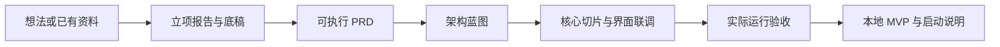

# Yukun 产品开发工作流

由 Yukun 负责流程设计、模块衔接、规则适配、验证和持续维护。

一个总入口，衔接三个现有模块：`ai-product-initiation` 负责立项与规划，`agent-blueprint` 负责架构与必要组件，`ai-product-starter-kit` 负责实施参考。默认目标是独立业务项目中的本地可验证 MVP。

## 流程



用户只要某个阶段时按其范围交付；已有 PRD 或项目时从当前阶段接续。关键选择确认后沿用，不因换模块重复访谈。

## 使用

把整个 `yukun-product-workflow/` 交给支持 Agent Skills、项目文件和终端操作的编码客户端。先读 [SKILL.md](SKILL.md)，不需要把三个模块分别安装到全局，也不要把业务项目放进本目录。

示例请求：

```text
请用 $yukun-product-workflow 帮我从想法推进到本地 MVP。
我的产品想法：把几份参考资料整理成带来源的需求草稿。
目标项目目录：使用我指定的项目文件夹；尚未指定时先向我确认。
已有材料和约束：沿用我这次提供的资料；额外收费和公开上线先确认。
```

想继续已有项目时，给出项目目录和本次目标即可。仅聊天、不能执行或写文件的客户端可以做前期方案，但无法完成运行验证。

## 包内结构

- `modules/ai-product-initiation/`：立项教练、报告组件、两套离线 HTML 模板和标准库渲染器。
- `modules/agent-blueprint/`：蓝图、必要组件参考、离线方法和可选引擎。默认使用当前会话分析，不自动配额外模型或运行安装脚本。
- `modules/ai-product-starter-kit/`：实施/前端/部署手册及参考代码。默认按独立业务项目使用，旧 `verify.sh` 已改为只读适配器。
- `references/`：立项到 PRD 的交接、阶段契约、实施与 MVP 验收。
- `assets/`：新项目才使用的项目规则、PRD 与状态模板；已有文件不覆盖。
- `scripts/check_project.py`：只读预检；`scripts/check_package.py`：本包文件与引用检查。

## 验证范围

```bash
python3 scripts/check_package.py
python3 -m unittest discover -s tests -p 'test_*.py'
```

项目预检从独立业务目录检查必要文件，不执行项目代码、联网、读取 Key 或写过程文件。静态通过不能证明模型质量、界面可用、用户效果或生产就绪。实际开发时仍需按 [MVP 验收](references/mvp-acceptance.md) 运行本项目测试、服务与真实核心任务。

## 维护、来源与许可证

此公开副本排除真实 `.env`、Git 历史、虚拟环境、缓存、编辑器配置和历史运行输出，清理固定个人路径；本机原来的三个模块保持原状。模块内保留的教学/历史样例不代表本整合包已完成实际业务 MVP。

保留 Agent Blueprint 的 MIT（Hubo）和 starter-kit 的 MIT（hubooooooo）许可及公开署名；立项模块沿用其现有来源状态，不给整个集合擅自添加统一授权。整合修改包括阶段调度、独立项目位置、交接契约、历史规则适配和只读预检。

默认不部署云资源。历史手册的模型、价格、限额、认证和平台操作在真正需要时以当前官方资料核验；任何额外付费、安装与对外动作遵守当前用户授权。
